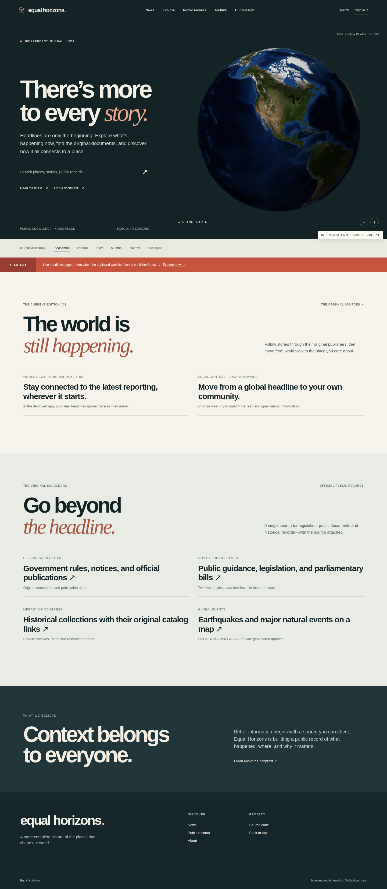

# Equal Horizons

**The news tells you what happened. Equal Horizons helps you find what happened before.**

Equal Horizons is a place-based news and public-records explorer. Start with a city or turn the Earth, read reporting from the original publisher, then open the documents and historical material behind a story. The idea grew out of a frustratingly simple problem: finding out what's going on somewhere shouldn't mean searching five different websites, three government portals, and an archive.

This project is being built for [Equal Horizons](https://www.equalhorizons.tech/), a nonprofit focused on making public information easier to find. It's a work in progress, and there's a lot of ground to cover.

### See it



[Mobile preview](docs/mobile-preview.png)

These screenshots show the visual direction. The deployed Next.js site loads live feeds and public records from the configured sources; provider availability varies. A deployment must be verified before presenting it as a working public link.

## What you can do

- **Start anywhere.** Turn the WebGL globe, search for a location, or jump straight to a city. When WebGL is disabled, a CPU-rendered sphere is still draggable; a local image covers the rare case where Canvas rendering is unavailable too.
- **Read the latest.** Global, national, and local publisher headlines link to original articles. Feeds report failures rather than inventing stories.
- **Go to the source.** Search available government publications, legislation, historical catalogs, and research metadata from one interface.
- **Understand events geographically.** See natural events from official feeds such as USGS and NASA EONET, then locate them on the Earth.
- **Keep track.** With Supabase configured, accounts support saved material and followed locations, while scheduled jobs maintain an archive.

Coverage isn't uniform. Some countries have excellent public APIs; others don't. Equal Horizons makes that distinction visible instead of pretending every place has identical records. Government search results are source links and metadata, not copies of licensed documents.

## Built with

| Layer | Technology |
| --- | --- |
| Application | Next.js App Router, React, TypeScript |
| Globe | Custom WebGL renderer, CPU Canvas fallback, and local Earth texture |
| Identity and storage | Supabase Auth, Postgres, row-level security |
| Data collection | Server-side RSS and JSON integrations, Vercel/Supabase scheduled functions |
| Styling | Hand-built CSS, system sans-serif + Georgia editorial type |
| Quality checks | Node's test runner, TypeScript, browser screenshots |

There's no third-party UI template or component library controlling the look. The navigation, layout, news index, source explorer, and globe interactions are all in this repository.

## Data sources

**15 adapters are implemented: 12 keyless sources and 3 integrations that require API keys.** Sources include GDELT, USGS, NASA EONET, GDACS, the Federal Register, Library of Congress, GOV.UK Content and Search, UK Parliament bills, Open-Meteo geocoding, Crossref, World Bank, Congress.gov, GovInfo, and Regulations.gov.

See [`public/sources.json`](public/sources.json) for the broader provider catalog. Entries marked `catalog` are research targets, **not connected integrations**. Keyless doesn't mean unlimited or unrestricted: review each provider's rate limits, licenses, terms, attribution, and acceptable use before scaling traffic.

The application requests data server-side and normalizes responses in [`lib/world-connectors.ts`](lib/world-connectors.ts). Original publisher URLs are preserved. Provider failures are surfaced without dumping credentials.

## Try it locally

Use Node.js 20.9 or newer and npm.

```bash
npm install
cp .env.example .env.local
npm run dev
```

Visit **http://localhost:3000**. The globe, routing, and keyless feeds can be explored without Supabase credentials. Accounts, the persistent archive, and paid/keyed government integrations need extra setup.

Run checks with:

```bash
npm test
npm run typecheck
npm run build
```

The Node suite now exercises the Canvas sphere with a simulated browser/canvas:
loading its texture, drawing frames, rotating to a city, handling pointer drag,
zoom limits, reset, and listener cleanup. It also verifies source selection,
result caps, and duplicate providers. These are unit-level checks, not a replacement
for a running build. An optional real-browser check is available:

```bash
npm run build
npm start
```

Open the app in a browser to check the real WebGL renderer and the Canvas fallback on your device.

`npm test` runs adapter tests and application regression tests. A production build is an additional requirement, not something the unit tests replace.

### Configuration

| Variable | Used for | Where it belongs |
| --- | --- | --- |
| `NEXT_PUBLIC_SUPABASE_URL` | Supabase project address | Client and server |
| `NEXT_PUBLIC_SUPABASE_ANON_KEY` | Supabase publishable/legacy anon key | Client and server |
| `SUPABASE_SERVICE_ROLE_KEY` | Archival and privileged reads | **Server only** |
| `CRON_SECRET` | Authorization for scheduled collection | **Server only** |
| `CONGRESS_API_KEY` | Congress.gov | **Server only** |
| `GOVINFO_API_KEY` | GovInfo | **Server only** |
| `REGULATIONS_API_KEY` | Regulations.gov | **Server only** |

Fill in the variables you need; you can start without any keys. Never add real keys to this repository or to `NEXT_PUBLIC_` variables. Supabase service keys bypass row-level security and must not reach browser code. Rotate any credentials that have been posted publicly or in chat.

## Deploying

1. Fork or push the root of this folder to a GitHub repository. `package.json` must be at the root.
2. Import the repository into [Vercel](https://vercel.com/). Framework preset: **Next.js**.
3. Add the environment variables listed above in **Project Settings → Environment Variables**. Choose appropriate Production/Preview/Development targets.
4. Create a Supabase project, then execute [`sql/INSTALL_ALL.sql`](sql/INSTALL_ALL.sql) once in its SQL editor. Review the security policies before processing user data.
5. Redeploy after changing environment variables. Check `/api/health`, `/api/news?scope=world`, `/api/discover?mode=records&country=GB&q=housing`, and `/api/world-events`.
6. Only after confirming database tables and keys are present, enable scheduled collection as described in [`sql/production-scheduler.sql`](sql/production-scheduler.sql). Vercel cron routes require the `CRON_SECRET` bearer token.

See [DEPLOY.md](DEPLOY.md) for a complete launch checklist, including how to debug failed upstream APIs and build errors. **Deploying the code isn't the same thing as enabling archival collection:** the scheduler, database, and source terms all need attention.

## Project map

```text
app/               Pages, two maintained stylesheets, HTTP endpoints
components/        Homepage globe, news, records, search and account views
lib/               Data normalization, geo helpers, RSS, WebGL renderer
public/media/      Bundled Earth texture
sql/               Database schema, permissions and scheduler
scripts/           Deployed smoke checks and optional offline browser test
tests/             Source adapter and app regression tests
docs/              Homepage screenshots for documentation
```

### Notes on the implementation

The public information work is deliberately divided in two: publisher reporting belongs in the news feed, while official sources and historical collections belong in the records explorer. Both link to the original provider. A blank response doesn't become a made-up headline or document.

The globe has two interactive rendering paths. WebGL draws the textured Earth on supported devices. When WebGL is disabled, `lib/globe-fallback.js` samples the same bundled equirectangular image onto a rotating sphere using Canvas 2D. The static image is only the final fallback. This matters on school-managed browsers and machines with graphics acceleration turned off.

The homepage globe UI is isolated in `components/HomeGlobe.tsx`, its featured
city list lives in `lib/globe-places.ts`, and the shared discovery service
is in `lib/world-service.ts`. The styles live in `app/site.css` for shared pages and `app/edition.css` for the homepage. Older unused concepts and duplicate globe components were removed rather than left in the deployed bundle. Data-source code remains separate from UI code so providers can be tested with mocked responses.

The UI for public records lives in [`components/GlobalSourcesExplorer.tsx`](components/GlobalSourcesExplorer.tsx). New source adapters belong in [`lib/world-connectors.ts`](lib/world-connectors.ts) and should be wired into [`lib/world-service.ts`](lib/world-service.ts). Avoid fetching third-party APIs directly from client components.

## Contributing

A useful contribution doesn't have to be a huge feature. A broken city link, better error message, trustworthy regional dataset, or a test for an edge case can all make the project better.

1. Search the issues before opening a new one.
2. Fork the repository and create a branch named for the change (`fix/uk-document-search`, for example).
3. Make the change with a small, clear commit. Include the original source URL for any new data integration.
4. Run `npm test`, `npm run typecheck`, and `npm run build` when dependencies are available.
5. Open a pull request explaining what changed, how you checked it, and any screenshots for UI work.

When adding sources, prefer primary-source links, documented licensing, safe URL handling, timeouts, and tests with mocked upstream responses. Please don't commit keys, copied full-text news articles, scraped personal data, or example records that could be mistaken for verified current events.

Read [`CONTRIBUTING.md`](CONTRIBUTING.md) for the checklist and accessibility expectations.

## Current limits

- Real-time feeds depend on upstream availability and rate limits. Not every article appears, and some services return only recent results.
- Municipal documents are highly fragmented across countries. A city-specific connector needs explicit sourcing and review.
- Search and archives are not a complete historical record until regular collection has been running.
- The 3D and Canvas renderers use an Earth map, **not live satellite imagery**. Texture attribution is in [`EARTH_TEXTURE_CREDITS.md`](EARTH_TEXTURE_CREDITS.md).
- A public deployment, production build verification, and end-to-end testing against live services are still required to call this release fully shipped.

If you're building an interface to public knowledge, good sourcing matters more than giant numbers or flashy dashboards. The goal is to help someone understand their community—and check the evidence for themselves.

---

**Equal Horizons** · [Nonprofit website](https://www.equalhorizons.tech/) · [Project source](https://github.com/Mithilessh2010/Newsy)

## Dependency reproducibility

This source archive does not yet include a validated `package-lock.json`. Do not generate a synthetic lockfile by hand. Run `npm install` in a network-enabled environment, verify `npm run typecheck`, `npm test`, and `npm run build`, then commit the resulting `package-lock.json`. After a verified lockfile is committed, update `.github/workflows/ci.yml` from `npm install` to `npm ci` and enable dependency caching.
